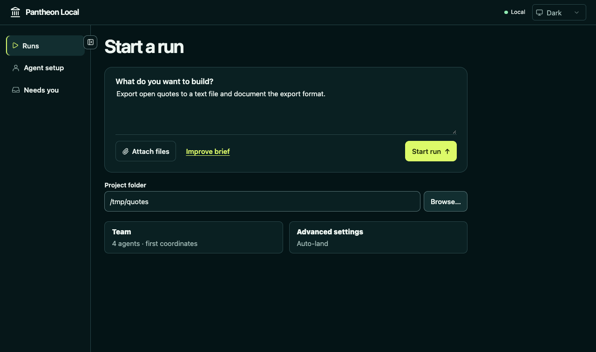
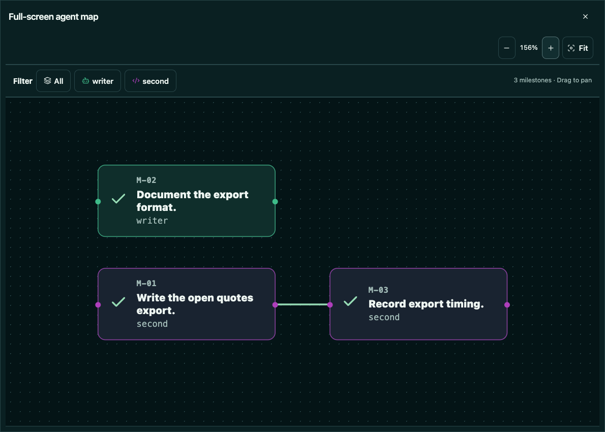
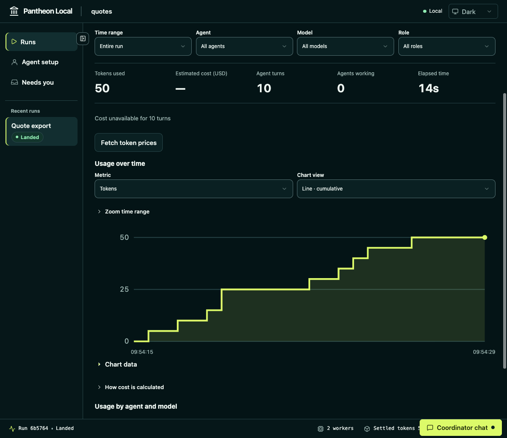
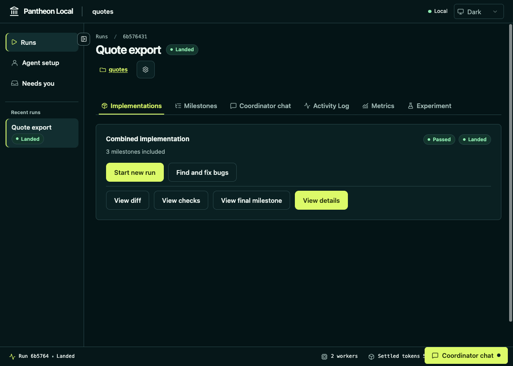
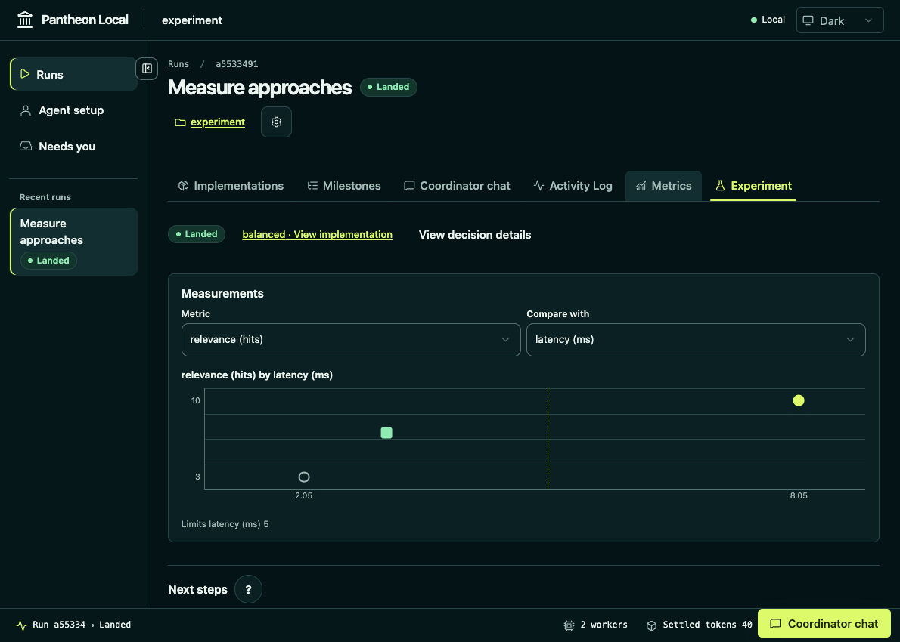

# Pantheon Local

Pantheon Local coordinates command-line coding agents on a local Git project. In the browser, you give the team a goal, answer the coordinator’s questions, and review a tested commit. For a single patch and a review, a direct CLI handoff is usually simpler.

## When to use it

- **Split one change across a team.** A coordinator can assign the API, interface, docs and integration check to four workers in separate checkouts. It clarifies what matters, passes decisions to the workers that need them, and brings unresolved questions to **Needs you**. Independent work continues. [Team coordination](docs/model-routing.md) · [Example briefs](examples/README.md)
- **Choose between implementations.** Test the starting commit and each alternative against the same checks. For search, that might mean finding more relevant results within a latency limit. Review the diff and measurements, keep the baseline, or combine parts of two candidates and test again. [Experiments and delivery](docs/experiments.md)

[Screenshot walkthrough](#screenshot-walkthrough) · [Project website](https://pantheon.talk/local)

## Quick start

### Build from source

On macOS or Linux, install rustup, Node.js 24, Git 2.39 or newer, and a coding-agent CLI. From the repository root, build the React workbench and launch the Rust executable.

```sh
npm --prefix web ci
npm --prefix web run build
cargo build --locked --release
./target/release/swarm open
```

If you have a Pantheon Local archive for your platform, extract it and run `./swarm open` from its folder. On macOS you can also double-click **Open Pantheon Local.command**.

In an interactive terminal, `swarm` and `swarm open` open the browser and show a rotating Pantheon mark while the workbench is online. Keyboard shortcuts appear in bold cyan when terminal colors are enabled. Click the local address or press **Enter** to open the signed-in workbench. Update notices appear below the address and link to the release. Keep the service window open. **Ctrl+C** stops the service in its original window or closes a reconnected view. Use `REDUCE_MOTION=1` for a still mark or `SWARM_PLAIN=1` for plain text. `swarm serve` and redirected output always print the link.

### Start a run

1. Configure your agent in its CLI or Hermes Desktop. Open **Runs → + New run** (or **Runs** for your first run), describe the goal, and attach any reference files. A new team starts with one coordinator and three workers. Under **Team**, use **Add agent** to choose a harness, model ID, and thinking effort. Add or remove workers to set the team size. Each agent has its own settings, even when several use the same harness.
2. Confirm the project folder (it defaults to the folder where you ran `swarm open`), then select **Start run**.
3. Answer any planning questions, then approve the checks. Follow live assignments and dependencies in **Milestones → Map** and monitor tokens and estimated cost in **Metrics**. Passing work auto-lands on your clean target branch unless you choose **Review before landing** in **Advanced settings**. [First run and troubleshooting](docs/getting-started.md)

**Runs** lists all runs with sortable status, milestone completion, settled token counts, and start times. Search by run name or project folder and filter by status. Select a row to open its workspace, then use the browser’s Back button to return to the filtered list. Collapse the sidebar with the divider button to see each recent run’s initials and status dot. The dot becomes a spinner while an agent is working. Hover over or focus a shortcut for the full run name and status. Open the project from the run title, or use **Run settings → Workspace** for the working folder, target branch, and full brief. Run tabs, milestones, and filtered activity and metrics views have their own URLs. Bookmarks reopen in an authenticated workbench session on the same local server.

## Screenshot walkthrough

These screenshots follow a sample quote-export project from brief to landed commit. The final example shows a separate search experiment.

<details>
<summary><strong>1. Start with a brief</strong></summary>

Choose the Git project that should receive the change. Open **Team** to pick the coordinator and workers, then select **Start run**.



</details>

**2. Follow the work in Milestones → Map**

Two workers can write the export and its documentation in parallel. The line from **Write the open quotes export** to **Record export timing** shows which task must finish first. Select a milestone to inspect its activity or a worker name to highlight their assignments.



<details>
<summary><strong>3. See where the tokens went</strong></summary>

In **Metrics**, the steps in the chart show cumulative token use over the run. Filter by agent, model, role, or time range to investigate a jump. If a turn has no price, **Fetch token prices** requests the rates needed to estimate its cost.



</details>

<details>
<summary><strong>4. Review the landed implementation</strong></summary>

Under **Implementations**, the **Passed** and **Landed** badges show that the build passed its checks and reached the target branch. Open **View diff** to inspect the change, **View checks** to see what ran, or **View details** to browse the committed files.



</details>

<details>
<summary><strong>5. Compare competing implementations</strong></summary>

In this **Experiment**, the candidate with the most relevant hits exceeds the 5 ms latency limit. The balanced candidate improves on the baseline and stays within the limit. Open **View decision details** to see why it landed.



</details>

## What runs where

Use the working folder link in **Run settings → Workspace** to open the selected project directory. Once a build passes, **Implementations** becomes the first run tab. The latest landed build appears first with a **Landed** badge. **Start new run** opens a blank brief for its folder and branch. **Find and fix bugs** starts a correctness run with the original swarm. Select **View details** to browse that build’s committed files, or **View final milestone** for its assignment. **Milestones** offers table, map, and Kanban views. Select a row to open its details, follow a dependency to its milestone, or sort by completion time. Use **Add task** or **Coordinator chat** to propose more work. **Activity Log** lets you search turns and inspect their output. **Metrics** shows the number of agents currently working, elapsed time, tokens and estimated costs by agent and model. Each agent uses its own tools, permissions and provider account. Hosted providers receive the context their CLIs send. Use trusted projects and scripts. [Architecture and adapter contract](docs/architecture.md)

## Contribute

[Development checks and bug reports](CONTRIBUTING.md) · [Apache-2.0 license](LICENSE) · [Notice](NOTICE)

To connect another coding harness or contribute a built-in integration, follow the [agent adapter guide](docs/agent-adapters.md).
